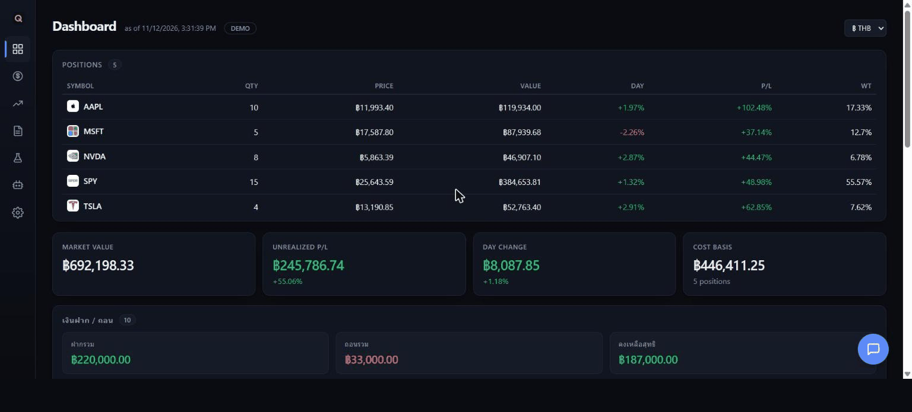

<p align="center">
  
</p>

<h1 align="center">QuantPa</h1>

<p align="center">
  <b>Personal quant dashboard</b>: live portfolio, markets, news and backtests, plus a chat assistant that reads your data through MCP tools.
</p>

<p align="center">
  
  
  
  
  
</p>

QuantPa is a single-user web app that runs on your own machine. A FastAPI backend pulls positions from Webull (or a CSV), prices them from live quotes, and reads your monthly statement PDFs. A React dashboard shows the results. A floating chat panel lets you ask questions in plain Thai or English. Claude answers by calling read-only MCP tools that use the same functions as the dashboard.

## Demo

<p align="center">
  
  <br>
  <sub>Recorded with <code>DEMO=1</code>. The holdings, deposits and tax figures are made up. Quotes, charts and news are live.</sub>
</p>

| | Page | What you'll see |
|:-:|---|---|
| 📊 | **Dashboard** | Positions with logos, value, day change and P/L in ฿ or $, totals, deposit/withdrawal history and a tax-prep summary |
| 📈 | **Markets** | Your Webull watchlists as logo cards with live prices. Click one for a TradingView chart and fundamentals |
| 📰 | **News** | CNBC and Yahoo headlines ranked by how much they affect your holdings |
| 🧪 | **Backtest Lab** | Equal-weight basket with an SMA timing rule, compared with buy-and-hold (CAGR, Sharpe, hit rate) |
| 💬 | **Chat assistant** | Floating panel on every page. Claude answers from live data through MCP tools |

> **Try it without an account:** set `DEMO=1` in `backend/.env`. You get sample positions and made-up cashflow and tax data, so no Webull login or statement files are needed.

## Overview

### Why a chat panel, and why read-only?

The dashboard answers the questions you planned for. The chat handles the rest, such as "which position lost the most this week, and what do its fundamentals look like?". Claude can only call **seven read-only tools**: portfolio, watchlists, news, economic calendar, cashflow, tax summary and fundamentals. It cannot place orders, run shell commands or read files. Built-in Claude Code tools are turned off, and your `~/.claude` settings and hooks are not loaded.

### How the chat reaches Claude

```
ChatWidget ─► POST /api/chat ─► chat.py: claude_agent_sdk.query()
                                   └─ spawns Claude Code (bundled CLI), signed in as this machine's user
                                   └─ in-process MCP server "quantpa"
                                        get_portfolio · get_watchlists · get_news · get_econ_calendar
                                        get_cashflow · get_tax_summary · get_fundamentals
```

The chat uses the **Claude Code login on this machine**, so it counts against your Claude plan. No API key is needed. If `ANTHROPIC_API_KEY` is set in the environment, Claude Code uses that key instead and bills API credits.

## Features

- **Live portfolio**: Webull OpenAPI positions (or a CSV) priced from CNBC quotes, with Yahoo as fallback. A stale-quote marker appears when a price is old. Toggle between ฿ and $ using the live USD/THB rate.
- **Cashflow and tax prep**: deposits and withdrawals parsed from your Webull monthly statement PDFs. Realized P/L is matched FIFO, alongside dividends, interest, fees and cash moved to Thailand. These are raw figures for your accountant. QuantPa does not compute tax owed.
- **Markets**: watchlists as cards with company logos, a TradingView chart per symbol, and Yahoo fundamentals (valuation, profitability, balance sheet).
- **News**: headlines matched to your sectors by keyword rules, tagged with the holdings they affect.
- **Economic calendar**: this week's high-impact ForexFactory events.
- **Backtest Lab**: SMA-filter signals on any basket, using adjusted close, against buy-and-hold benchmarks.
- **Chat assistant**: Claude through the Agent SDK. The model and effort are configurable, sessions resume, and replies come in your language.
- **Demo mode**: `DEMO=1` swaps every source of personal data for made-up numbers, for screenshots and recordings.

## Architecture

```
backend/
  main.py            # FastAPI app: every /api endpoint
  chat.py            # Chat assistant: Claude Agent SDK + in-process MCP tools
  webull_sync.py     # Webull OpenAPI positions & watchlists
  portfolio.py       # Positions → priced portfolio + totals
  market.py          # Quotes (CNBC → Yahoo fallback) and price history
  cashflow.py        # Deposits/withdrawals from statement PDFs
  tax_summary.py     # Realized P/L (FIFO), dividends, interest, fees
  fundamentals.py    # Yahoo quoteSummary metrics
  news.py            # Headlines + portfolio relevance rules
  ff_calendar.py     # ForexFactory high-impact events
  backtest.py        # Backtest engine
  demo.py            # Made-up data for DEMO=1
  tests/             # pytest suite (+ testdata/)
  scripts/           # export_cashflow.py: statements → CSV
  research/          # standalone research scripts
frontend/src/
  App.jsx            # Shell, Dashboard, Settings
  api.js             # fetch helpers + polling hook
  components/        # Sidebar, Markets, News, Backtest, ChatWidget, StockLogo, ...
start.bat / stop.bat # one-click launch / shutdown on Windows
```

## Getting Started

**One click (Windows):** run `start.bat`. It starts the backend and a production build of the frontend with no console windows, then opens the app at <http://localhost:5173>. Run `stop.bat` to shut both down.

**Manual:**

```bash
# backend
cd backend
python -m venv .venv
.venv\Scripts\activate          # Windows
pip install -r requirements.txt
uvicorn main:app --reload --port 8000

# frontend (second terminal)
cd frontend
npm install
npm run dev                      # http://localhost:5173
```

The chat assistant also needs **Claude Code installed and signed in** on the same machine. Run `claude` once and log in. The Python SDK starts its own bundled copy of the CLI, which reads that login.

### Configuration: `backend/.env`

| Key | Default | What it does |
|---|---|---|
| `PORTFOLIO_SOURCE` | `csv` | `csv` or `webull` |
| `PORTFOLIO_CSV` | `sample_portfolio.csv` | CSV with `symbol,quantity,avg_cost` |
| `WEBULL_APP_KEY` / `WEBULL_APP_SECRET` | | Webull OpenAPI credentials (see below) |
| `WEBULL_REGION_ID` | | `us`, `th`, `hk`, `jp`, ... |
| `WEBULL_ACCOUNT_ID` | first account | Optional |
| `CHAT_MODEL` | `claude-sonnet-5-5` | Model the chat uses |
| `CHAT_EFFORT` | `medium` | `low` · `medium` · `high` · `xhigh` · `max` |
| `DEMO` | off | `1` = sample and made-up data everywhere |

`.env` is git-ignored. Never commit real keys.

### Webull sync

Positions come straight from the **official Webull OpenAPI** (App Key + App Secret, HMAC-signed).

1. Apply for API access at your region's developer portal, for example [developer.webull.co.th](https://developer.webull.co.th). The US portal is geo-blocked outside the US.
2. Generate an App Key and App Secret, fill in `backend/.env`, set `PORTFOLIO_SOURCE=webull` and restart the backend.
3. The first connection asks you to **approve the login in the Webull mobile app**. If the dashboard shows *"Webull auth failed — check Webull authentication"*, approve the request on your phone and refresh.

Credentials stay on the server, and positions are **read-only**: QuantPa never places orders.

> **Windows install note:** on non-UTF-8 locales such as Thai, `pip install` can fail with `UnicodeDecodeError ... cp874`. Run `$env:PYTHONUTF8=1; pip install -r requirements.txt` instead.

### Statements (cashflow & tax)

Put your Webull monthly statement PDFs in `backend/deposit_history/` (git-ignored). Results are cached and re-parsed only when a file is added or changed.

## Tests

```bash
cd backend
pytest
```

## Tech Stack

- **Backend:** Python 3.12, FastAPI, curl_cffi, pandas, Webull OpenAPI SDK
- **Frontend:** React 18, Vite, Recharts, TradingView widget
- **AI:** [Claude Agent SDK](https://code.claude.com/docs/en/agent-sdk) with in-process MCP tools

## Notes

- Not investment advice. QuantPa shows and analyzes your data; you decide and you trade.
- Symbols are Yahoo/CNBC tickers (`AAPL`, `0700.HK`, ...). `BRK B` from Webull is mapped to `BRK.B` for logos.
